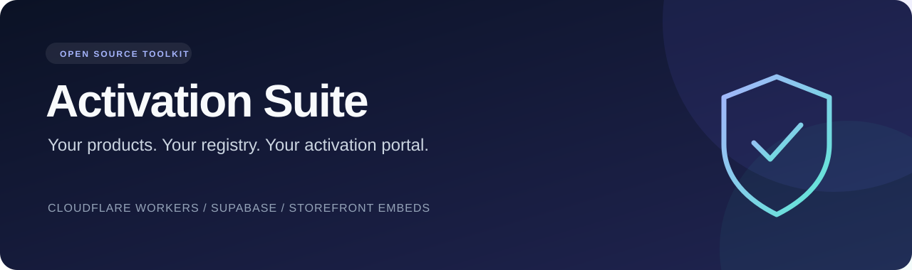
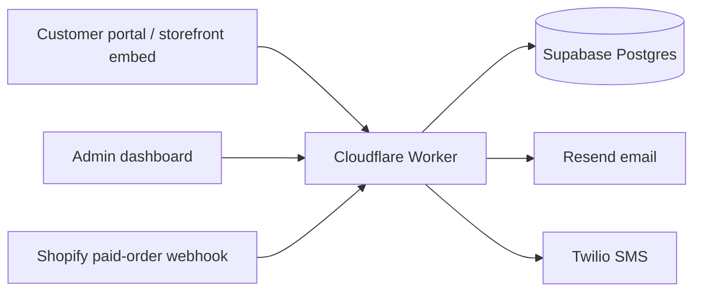

<div align="center">



# Activation Suite

**Your products. Your registry. Your activation portal.**

An open-source product registration and license-management toolkit for Cloudflare Workers and Supabase, with a branded customer portal and an integrated admin dashboard.


[Quick start](#quick-start) · [Deployment](docs/deployment.md) · [Storefront integrations](docs/integrations.md) · [API](docs/api.md) · [Security & limitations](docs/security.md)

</div>

## What it does

Give customers a place to register a serial number, provide their contact details, and receive a generated license key. Manage products, administrator accounts, branding, and provider settings from a browser dashboard.

| For customers | For administrators | For your storefront |
| --- | --- | --- |
| Serial-number registration | Product registry and bulk creation | Shopify theme sections |
| Email/SMS OTP flow | One-time and unlimited-use records | WordPress / Elementor embed |
| Direct activation option | Expiration and activation tracking | BigCommerce embed |
| Generated license keys | Branding and integration settings | Wix HTML embed |
| Activation certificate emails | Live activity over WebSockets | Generic HTML widget |

Resend handles email, Twilio handles SMS, and an optional Shopify paid-order webhook provisions serial numbers. External service accounts and usage charges are separate.

> **Project status: initial source recovery / developer preview.** This release restores editable JavaScript from a supplied distribution. It retains known security and reliability limitations. Read [the inspection findings](docs/security.md) before exposing it to customers. The OTP Worker also exposes a direct-activation endpoint; OTP is currently a user-interface flow, not an enforced server policy.

## How it fits together



This project manages your own product registry. License strings are registry identifiers; the package does not include client-side license enforcement, signed offline licenses, device binding, or activation of third-party software.

## Quick start

Requirements: Node.js 22 or newer and npm. Cloudflare and Supabase accounts are needed for a hosted installation.

```bash
npm ci
```

Copy `.dev.vars.example` to `.dev.vars` and set `ADMIN_EMAIL` and `ADMIN_PASSWORD`. For a disposable local demo, leave Supabase and delivery providers unconfigured:

```bash
npm run dev
```

Open the local URL printed by Wrangler (usually `http://localhost:8787`):

| Path | Purpose |
| --- | --- |
| `/` or `/portal` | Customer portal with OTP steps |
| `/portal-no-otp` | Direct activation portal |
| `/admin` | Admin dashboard |
| `/api/health` | Runtime and database connectivity |

Demo serials: `SN-DEMO-001` (one-time) and `SN-DEMO-002` (unlimited). Without a delivery provider, the OTP flow returns the test code to the browser. Local demo data lives in process memory and can disappear on reload or restart.

To use a Worker whose default portal skips OTP:

```bash
npm run dev:no-otp
```

## Deploy your own instance

1. Run [database/schema.sql](database/schema.sql) in a fresh Supabase project's SQL editor. Demo records are a separate, optional [seed script](database/seed-demo.sql); no default administrator is inserted.
2. Configure the Worker credentials using Wrangler secrets or the Cloudflare dashboard. Keep the Supabase service-role key on the server.
3. Deploy the selected variant and check `/api/health`.
4. Configure delivery providers, branding, and storefront URLs.

See [the deployment guide](docs/deployment.md) for exact commands and [the integration guide](docs/integrations.md) for platform-specific files.

## Development

```bash
npm run check    # Parse application and inline browser scripts; check local docs links
npm test         # Exercise both Workers with disposable in-memory data
npm run build    # Generate self-contained Worker bundles in dist/
```

| Location | Contents |
| --- | --- |
| `src/worker.js` | OTP-default Worker and API |
| `src/worker-no-otp.js` | Direct-activation-default Worker and API |
| `src/templates/` | Shared admin and customer HTML templates |
| `integrations/` | HTML embeds and Shopify sections/snippets |
| `database/` | Schema and optional demo records |
| `docs/` | Setup, API, provenance, and inspection notes |
| `test/` | Local Worker smoke and regression tests |

The two Worker files currently duplicate backend logic. Apply behavior changes to both, or propose a shared implementation. Original TypeScript types and source maps were not present. See [provenance](docs/provenance.md) for recovery details and [third-party notices](THIRD_PARTY_NOTICES.md) for dependency attribution.

## Contributing

Bug reports, documentation improvements, and pull requests are welcome. Start with [CONTRIBUTING.md](CONTRIBUTING.md). Please report security issues privately using the process in [SECURITY.md](SECURITY.md).

## License

[MIT](LICENSE) © 2026 ShadowEyad. Third-party dependencies retain their own licenses.
